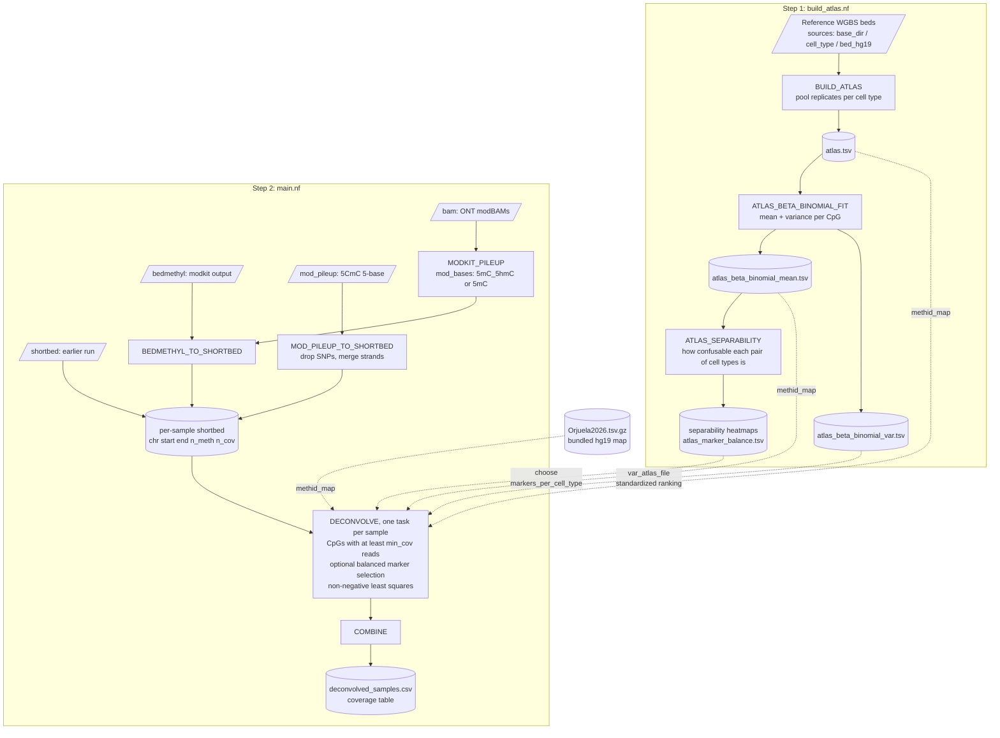

# MethID

MethID estimates the cell-type contributions to a cell-free DNA sample from low-coverage, whole-genome
methylation data. It fits a non-negative least squares model of reference cell-type methylation profiles to the
sample's methylation at every CpG covered at least `min_cov` times.

It runs as two Nextflow pipelines on a SLURM cluster, each with one params file and one launch script:

| Step | Pipeline | Params file | Launch script |
|---|---|---|---|
| 1. Build a reference map (once per map) | `build_atlas.nf` | `params_build_map.json` | `launch_build_map.sh` |
| 2. Deconvolve samples | `main.nf` | `params_deconvolve.json` | `launch_deconvolve.sh` |

Step 1 is optional. `Orjuela2026.tsv.gz`, the hg19 map used for figure 5C in Orjuela et al. 2026, works as is.



```
MethID/
├── build_atlas.nf            # pipeline: build a reference map
├── main.nf                   # pipeline: deconvolve samples
├── params_build_map.json     # settings for build_atlas.nf
├── params_deconvolve.json    # settings for main.nf
├── launch_build_map.sh       # sbatch launcher for build_atlas.nf
├── launch_deconvolve.sh      # sbatch launcher for main.nf
├── nextflow.config           # SLURM resources and the container
├── Dockerfile                # container recipe
├── Orjuela2026.tsv.gz        # bundled hg19 reference map
└── bin/                      # R scripts the pipelines call
```

## Setup

### 1. Clone the repo on the cluster

```bash
git clone git@github.com:horjuel1/MethID_updated.git
```

### 2. Build the container (on a local machine with Docker)

The container holds R 4.4 with every package the pipelines use, samtools and modkit 0.6.1.

```bash
docker buildx build --platform linux/amd64 -t methid --load .
```

`--platform linux/amd64` is required: the cluster is x86 and the R package binaries are amd64 only. On Apple
Silicon the build runs under emulation and is slower.

Then convert it to a Singularity image. Either convert on your machine using Singularity in Docker (the same
version as the cluster's module):

```bash
docker save methid:latest -o methid.tar
docker run --rm --privileged --platform linux/amd64 -v "$PWD:/work" -w /work \
    quay.io/singularity/singularity:v3.11.4 build methid.sif docker-archive:///work/methid.tar
```

or copy `methid.tar` to the cluster and run `singularity build methid.sif docker-archive://methid.tar` there
(add `--fakeroot` if it fails on permissions).

### 3. Place the container

`nextflow.config` expects `methid.sif` in the folder above the repo. To keep it elsewhere, change `container`
in `nextflow.config` to its full path.

```
parent-directory/
├── methid.sif
└── MethID_updated/
```

Check it:

```bash
singularity exec methid.sif modkit --version
singularity exec methid.sif Rscript -e 'library(GenomicRanges); library(limSolve); cat("ok\n")'
```

Rebuild the container only when `Dockerfile` or `bin/requirements.r` change. The pipelines run the scripts in
`bin/` from the repo, not from inside the container.

## Running

Edit the params file, then submit from the repo folder. Logs go to `logs/`, and Nextflow's work files go to
`$MYSCRATCH/nextflow_work/`.

```bash
sbatch launch_build_map.sh
sbatch launch_deconvolve.sh
```

Both launchers take another params file as the first argument, and pass anything after it to Nextflow:

```bash
sbatch launch_deconvolve.sh params_my_project.json -resume
```

## 1. Building a reference map (`params_build_map.json`)

`build_atlas.nf` is the same atlas pipeline as smMethID's. It pools the reference WGBS replicates per cell type,
fits a beta-binomial model, and measures how separable the cell types are.

| Field | Default | Description |
|---|---|---|
| `sources` | — | The reference beds: `{ "<source>": { "base_dir": "...", "cell_types": [...] } }`. Each cell type is read from `<base_dir>/<cell_type>/<bed_subdir>/*.bed` and named `<source>_<cell_type>`. |
| `bed_subdir` | `bed_hg19` | Folder under each cell type holding its beds (`chr start end meth cov`). |
| `samples_to_exclude` | `false` | Comma-separated bed file names to leave out. |
| `outdir` | `results_atlas` | Output folder. |
| `min_coverage` | `10` | Minimum pooled reads for a CpG to be reported. Keep it at 10 or more for `standardized` marker ranking. |
| `cpus` | `4` | CPUs for pooling. |
| `bb_min_df_for_dispersion`, `bb_min_phi`, `bb_max_phi` | `30`, `0.0001`, `0.999` | Beta-binomial fit settings. |
| `separability_marker_sets` | `5000,20000` | Panel sizes (markers per cell type) to also compute separability for; `""` to skip. |

Instead of `sources`, you can give `mapped_bed_dirs` (a comma-separated list of per-cell-type bed folders) or
`config` (a separate JSON file in the `sources` format). Use only one of the three.

Outputs in `outdir`:

- `atlas.tsv`: replicates pooled (sum of methylated reads / sum of reads), one column per cell type. Usable as `methid_map`.
- `atlas_beta_binomial_mean.tsv`: the beta-binomial mean per CpG. Also usable as `methid_map`.
- `atlas_beta_binomial_var.tsv`: the per-CpG variance, for `marker_ranking: standardized`.
- `atlas_pair_separability.csv` and `atlas_confusability_map*.png`: how hard each pair of cell types is to tell
  apart, on all CpGs and on each `separability_marker_sets` panel.
- `atlas_marker_balance.tsv`: per cell type, how many CpGs set it apart from its closest other cell type, and how
  strong its 5,000th / 20,000th / 50,000th best marker is. Use it to choose `markers_per_cell_type`.
- `atlas_sources.json`: the `sources` used, for the record.

## 2. Deconvolving samples (`params_deconvolve.json`)

| Field | Default | Description |
|---|---|---|
| `methid_map` | — | Reference map: `chr start end <cell type betas...>`, betas from 0 to 1, same genome build as the samples. |
| `input_file_type` | `bam` | What the inputs are: `bam`, `mod_pileup` (5CmC), `bedmethyl`, or `shortbed` (see below). |
| `input_dir` | — | Folder with the inputs. Use this or `sample_sheet`. |
| `sample_sheet` | `false` | TSV listing the inputs (see below). Use this or `input_dir`. |
| `ref_genome` | — | Reference FASTA. BAM input only. |
| `mod_bases` | `5mC_5hmC` | BAM input only. `5mC_5hmC` counts 5mC and 5hmC together as methylated, matching WGBS-based maps; `5mC` counts 5mC alone. |
| `markers_per_cell_type` | `0` | Marker selection (see below). `0` uses every CpG in the map. |
| `marker_ranking` | `gap` | `gap` or `standardized`. |
| `var_atlas_file` | `false` | `atlas_beta_binomial_var.tsv`, needed for `standardized`. |
| `outdir` | `results` | Output folder. |
| `min_cov` | `2` | Minimum reads at a CpG for it to be used. |

### Input types

| `input_file_type` | `input_dir` holds | Sample name |
|---|---|---|
| `bam` | `*.bam` with `.bai` indexes (ONT, MM/ML tags) | BAM file name |
| `mod_pileup` | 5CmC sample folders, each with `mod_pileup.txt` | folder name before the CG-Align suffix |
| `bedmethyl` | `*.bed` from `modkit pileup` | file name |
| `shortbed` | `*_short.bed` from an earlier MethID run (`<outdir>/shortbeds`) | file name before `_short` |

**5-base / 5CmC (`mod_pileup`).** Point `input_dir` at the 5CmC project folder, for example
`/dcs10/scharpf/data/5b-project-hub/2026-03_5-Base_Healthy_Ref`. Every
`<sample>_bt2-bwa_umi_true_hg19_wm_idt_spike_v0.1/mod_pileup.txt` is picked up and named `<sample>`
(`CGPLH339P_5B_lib2`). Positions where the sample's genotype isn't the reference C (`C/C` on `+`, `G/G` on `-`)
are dropped, since C>T SNPs look like methylation. The two strands are then summed per CpG, as
`modkit pileup --combine-strands` does. No `ref_genome` is needed.

**Sample sheet.** A tab-separated file with columns `id`, `label` and `path` (`bam_path` also works, so MethID
1.0.2 sheets can be reused). `path` is the full path to each input of the chosen `input_file_type`. Samples are
named `<id>_<label>`.

```
id	label	path
CGPLH339P	lib2	/dcs10/.../CGPLH339P_5B_lib2_bt2-bwa_umi_true_hg19_wm_idt_spike_v0.1/mod_pileup.txt
P001	baseline	/abs/path/P001.bam
```

### Marker selection

This works the same way as in smMethID and runs at deconvolution time, so one map serves any panel size. With
`markers_per_cell_type: N`, for each cell type MethID keeps the N CpGs where it differs most from its closest other
cell type, and pools them, so every cell type is represented equally. CpGs with a missing beta for any cell type
are dropped first.

- `gap` ranks by the difference in beta to the closest other cell type.
- `standardized` divides that difference by the combined replicate SD of the two cell types, so CpGs where
  replicates disagree rank low. It needs `var_atlas_file` and a map built with `min_coverage` of 10 or more.

```json
"methid_map": "/path/to/results_atlas/atlas_beta_binomial_mean.tsv",
"markers_per_cell_type": 5000,
"marker_ranking": "standardized",
"var_atlas_file": "/path/to/results_atlas/atlas_beta_binomial_var.tsv"
```

For the same map and settings, the selected CpGs are identical to smMethID's. MethID only uses panel CpGs a sample
covers at least `min_cov` times, so with low-coverage cfDNA use larger panels than smMethID needs, and check
`overlap_sites` in the coverage table.

### Outputs

- `<outdir>/deconvolution/deconvolved_samples.csv`: cell-type percentages, one column per sample.
- `<outdir>/deconvolution/coverage_<date>.tsv`: per sample, CpGs in the input (`sample_sites`), CpGs used
  (`overlap_sites`) and the map or panel size (`atlas_length`).
- `<outdir>/deconvolution/per_sample/`: the same, one file per sample.
- `<outdir>/shortbeds/`: per-sample methylated and total read counts per CpG, reusable with `input_file_type: shortbed`.
- `<outdir>/bedmethyl/`: modkit output (BAM input only).
